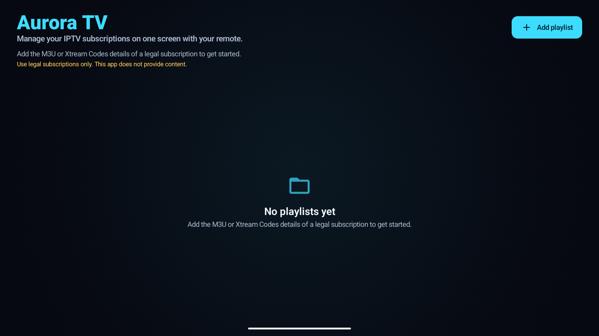
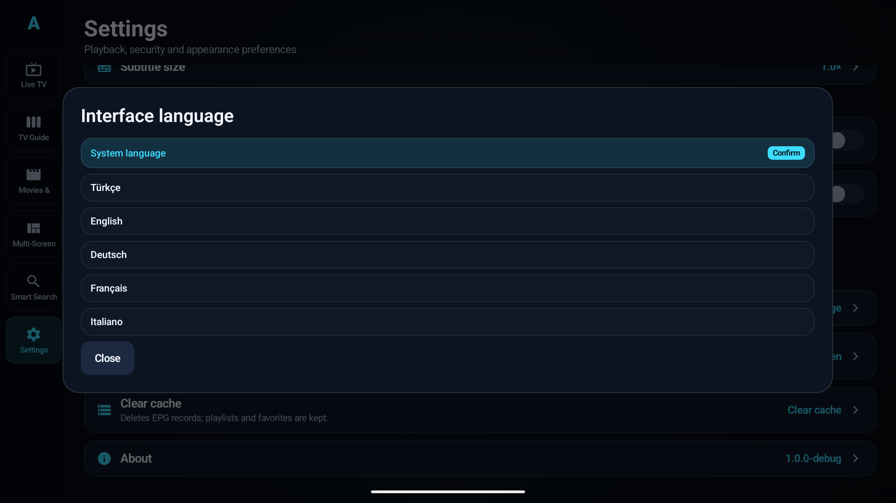
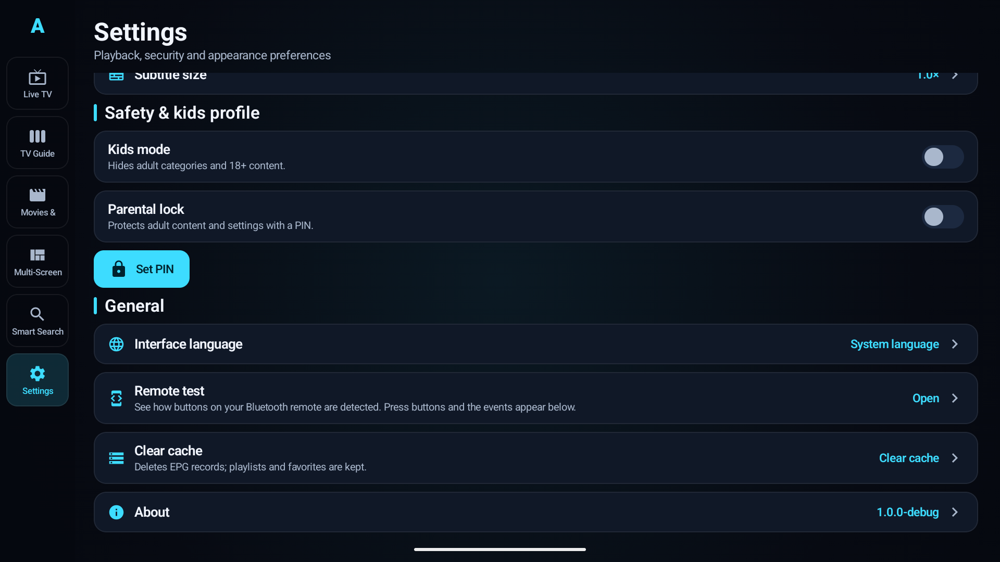

<p align="center">
  
</p>

<h1 align="center">Aurora TV</h1>

<p align="center">
  A modern IPTV player for Android phones, tablets, Android TV and TV boxes.<br>
  M3U and Xtream Codes sources, 7-day XMLTV EPG, multi-screen playback and on-device smart search.<br>
  Available in Turkish, English, German, French and Italian.
</p>

<p align="center">
  <b>English</b> · <a href="README.tr.md">Türkçe</a>
</p>

<p align="center">
  
  
  
  
</p>

---

## Overview

**Aurora TV** is a native Android IPTV client written in Kotlin with Jetpack Compose. It plays the
legal M3U or Xtream Codes subscription that **you** add — the app ships with no playlists, channels,
movies or series.

The interface is designed for both touch and D-pad: phones, tablets, Android TV and TV boxes share the
same codebase. Playback is handled by Media3/ExoPlayer, including HLS and DASH, with background audio,
picture-in-picture and an optional external player.

> **Empty by design.** On first launch Aurora TV opens the setup screen and asks for a source.
> There is no bundled or demo content.

## Screenshots

<table>
  <tr>
    <td></td>
    <td></td>
    <td></td>
  </tr>
  <tr>
    <td align="center"><sub>Empty first launch</sub></td>
    <td align="center"><sub>Five-language picker</sub></td>
    <td align="center"><sub>Settings</sub></td>
  </tr>
</table>

<p align="center"><sub>Captured from the debug build on an Android emulator at 1920 × 1080, D-pad layout.
The app starts empty; no playlist or content is bundled.</sub></p>

## Features

- **Sources:** M3U URL, local M3U file and Xtream Codes, each with an optional EPG URL.
- **EPG:** XMLTV, 7 days, programme details, reminders and catch-up links.
- **Live TV:** category browsing, favourites, channel zapping and a D-pad friendly layout.
- **Multi-screen:** 2 or 4 simultaneous streams with per-tile channel and audio control.
- **Smart search:** on-device search with Turkish character normalisation, synonyms, intent detection
  and fuzzy matching. No query leaves the device.
- **Profiles and child mode:** separate watch history, 4-digit PIN (salted SHA-256) and an age filter.
- **Playback:** HLS/DASH, background audio through a MediaSessionService, PiP, external player support.
- **TV extras:** remote-control test, boot receiver for optional auto-start, focus-first navigation.
- **Languages:** Turkish, English, German, French and Italian. The language is selected in Settings,
  remembered across launches and applied without restarting the app.

## Languages

The app detects the system language on first launch. If it is not one of the five supported languages,
Aurora TV starts in Turkish. The choice can be changed at any time:

**Settings → Language → Türkçe / English / Deutsch / Français / Italiano**

## Requirements

- Android 7.0 (API 24) or newer
- JDK 17 or newer
- Android SDK Platform 35 and Build Tools 34+

## Build from source

```bash
git clone https://github.com/talatozunal/AuroraTV-Android.git
cd AuroraTV-Android

# Point Gradle at your local Android SDK (or set ANDROID_HOME)
echo "sdk.dir=$HOME/Library/Android/sdk" > local.properties

./gradlew assembleDebug
# output: app/build/outputs/apk/debug/app-debug.apk
```

Release builds need your own signing key. See `app/build.gradle.kts`; the release build type is
intentionally not configured with a keystore in this repository.

## Adding a source

1. Open **Playlists** (or the first-launch setup screen).
2. Choose **M3U URL**, **M3U file** or **Xtream Codes**.
3. Enter the URL and, if available, the XMLTV EPG URL.
4. Start the sync. Channels, movies, series and EPG are stored locally in Room.

## Project structure

```
app/src/main/java/com/aurora/iptv/
├─ data/        Room entities, DAOs, repositories, M3U/XMLTV/Xtream parsers
├─ net/         OkHttp client and HTTP helpers
├─ playback/    Media3 player factory, playback service, external players
├─ search/      On-device smart search
├─ security/    Content filter for child profiles
├─ tv/          Boot receiver and TV-specific helpers
└─ ui/          Compose screens, components and theme
```

- **UI:** Jetpack Compose + Material 3, manual dependency injection through `AppContainer`.
- **Storage:** Room for content and EPG, DataStore for settings.
- **Networking:** OkHttp; parsing is streaming and happens off the main thread.
- **Playback:** Media3 ExoPlayer with HLS, DASH and an OkHttp data source.

## Privacy and legal

Aurora TV is a media player. It does **not** provide, host or bundle any channel, movie, series,
subscription or playlist. It only plays sources that the user enters and is legally allowed to access.

All app data stays on the device. There is no account, no analytics and no developer-operated server.
See [DISCLAIMER.md](DISCLAIMER.md) and [SECURITY.md](SECURITY.md).

## License

MIT — see [LICENSE](LICENSE). Third-party components are listed in
[THIRD_PARTY_NOTICES.md](THIRD_PARTY_NOTICES.md).
