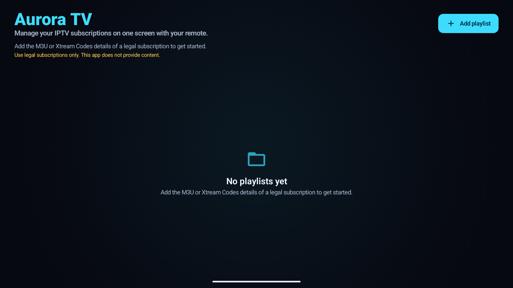
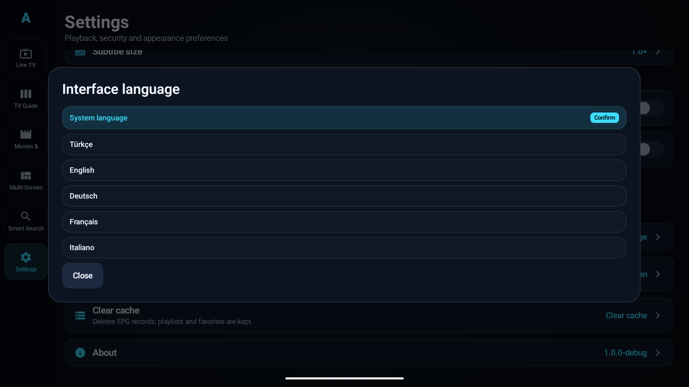
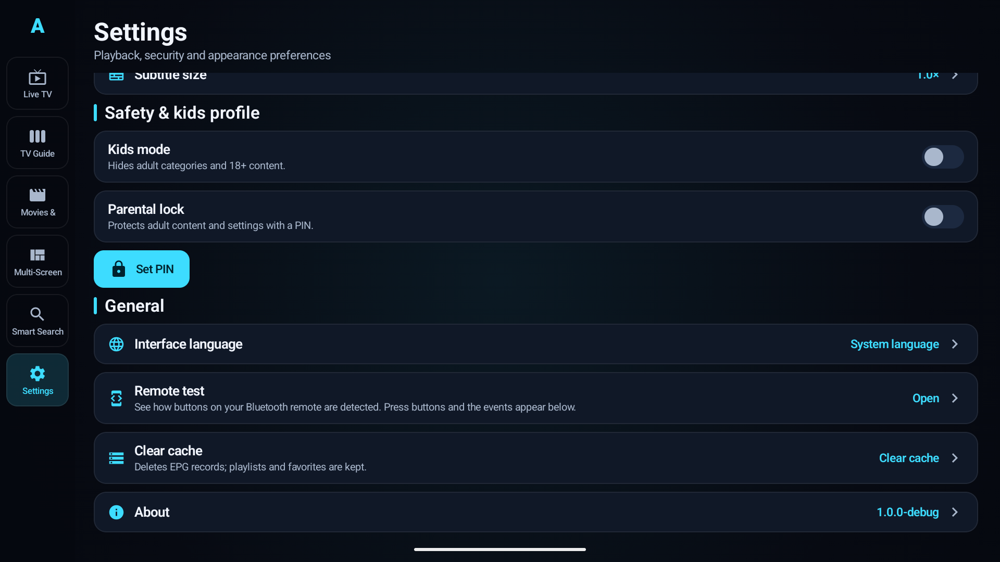

<p align="center">
  
</p>

<h1 align="center">Aurora TV</h1>

<p align="center">
  Android telefon, tablet, Android TV ve TV kutuları için modern IPTV oynatıcı.<br>
  M3U ve Xtream Codes kaynakları, 7 günlük XMLTV EPG, çoklu ekran ve cihaz üstü akıllı arama.<br>
  Türkçe, İngilizce, Almanca, Fransızca ve İtalyanca olarak kullanılabilir.
</p>

<p align="center">
  <a href="README.md">English</a> · <b>Türkçe</b>
</p>

<p align="center">
  
  
  
  
</p>

---

## Genel bakış

**Aurora TV**, Kotlin ve Jetpack Compose ile yazılmış yerel bir Android IPTV istemcisidir. Yalnızca
**sizin** eklediğiniz yasal M3U veya Xtream Codes aboneliğini oynatır — uygulamayla birlikte hiçbir
oynatma listesi, kanal, film veya dizi gelmez.

Arayüz hem dokunmatik hem de D-pad için tasarlandı: telefon, tablet, Android TV ve TV kutuları aynı
kod tabanını kullanır. Oynatma Media3/ExoPlayer ile yapılır; HLS ve DASH, arka plan sesi, PiP ve
isteğe bağlı harici oynatıcı desteklenir.

> **Bilinçli olarak boş.** İlk açılışta Aurora TV kurulum ekranını açar ve kaynak ister.
> Gömülü veya demo içerik yoktur.

## Ekran görüntüleri

<table>
  <tr>
    <td></td>
    <td></td>
    <td></td>
  </tr>
  <tr>
    <td align="center"><sub>Boş ilk açılış</sub></td>
    <td align="center"><sub>Beş dilli seçici</sub></td>
    <td align="center"><sub>Ayarlar</sub></td>
  </tr>
</table>

<p align="center"><sub>Android emülatörde 1920 × 1080, D-pad düzeninde debug derlemesinden alındı.
Uygulama boş açılır; hiçbir oynatma listesi veya içerik paketlenmez.</sub></p>

## Özellikler

- **Kaynaklar:** M3U URL, yerel M3U dosyası ve Xtream Codes; her birine isteğe bağlı EPG adresi.
- **EPG:** XMLTV, 7 gün, program detayı, hatırlatıcı ve catch-up bağlantısı.
- **Canlı TV:** kategori gezinme, favoriler, kanal geçişi ve D-pad uyumlu düzen.
- **Çoklu ekran:** 2 veya 4 eşzamanlı yayın; hücre başına kanal ve ses kontrolü.
- **Akıllı arama:** Türkçe karakter normalizasyonu, eş anlamlılar, niyet algılama ve bulanık eşleşme.
  Arama tamamen cihazda çalışır; sorgu dışarı gitmez.
- **Profiller ve çocuk modu:** ayrı izleme geçmişi, 4 haneli PIN (tuzlanmış SHA-256) ve yaş filtresi.
- **Oynatma:** HLS/DASH, MediaSessionService ile arka plan sesi, PiP, harici oynatıcı desteği.
- **TV ekstraları:** kumanda testi, isteğe bağlı otomatik başlatma ve odak öncelikli gezinme.
- **Diller:** Türkçe, İngilizce, Almanca, Fransızca ve İtalyanca. Dil Ayarlar'dan seçilir, hatırlanır
  ve uygulama yeniden başlatılmadan uygulanır.

## Diller

Uygulama ilk açılışta sistem dilini algılar. Dil beş desteklenen dilden biri değilse Aurora TV Türkçe
açılır. Tercih her zaman değiştirilebilir:

**Ayarlar → Dil → Türkçe / English / Deutsch / Français / Italiano**

## Gereksinimler

- Android 7.0 (API 24) veya üzeri
- JDK 17 veya üzeri
- Android SDK Platform 35 ve Build Tools 34+

## Kaynaktan derleme

```bash
git clone https://github.com/talatozunal/AuroraTV-Android.git
cd AuroraTV-Android

# Gradle'ı yerel Android SDK'ya yönlendirin (veya ANDROID_HOME tanımlayın)
echo "sdk.dir=$HOME/Library/Android/sdk" > local.properties

./gradlew assembleDebug
# çıktı: app/build/outputs/apk/debug/app-debug.apk
```

Release derlemeleri kendi imzalama anahtarınızı gerektirir. `app/build.gradle.kts` dosyasına bakın;
bu depoda release build type bilinçli olarak keystore ile yapılandırılmamıştır.

## Kaynak ekleme

1. **Oynatma Listeleri** ekranını açın (ilk açılışta kurulum ekranı).
2. **M3U URL**, **M3U dosyası** veya **Xtream Codes** seçin.
3. URL'yi ve varsa XMLTV EPG adresini girin.
4. Eşitlemeyi başlatın. Kanal, film, dizi ve EPG verisi Room'da yerel olarak saklanır.

## Proje yapısı

```
app/src/main/java/com/aurora/iptv/
├─ data/        Room varlıkları, DAO'lar, depolar, M3U/XMLTV/Xtream ayrıştırıcıları
├─ net/         OkHttp istemcisi ve HTTP yardımcıları
├─ playback/    Media3 oynatıcı fabrikası, oynatma servisi, harici oynatıcılar
├─ search/      Cihaz üstü akıllı arama
├─ security/    Çocuk profilleri için içerik filtresi
├─ tv/          Önyükleme alıcısı ve TV yardımcıları
└─ ui/          Compose ekranları, bileşenler ve tema
```

- **Arayüz:** Jetpack Compose + Material 3, `AppContainer` ile manuel bağımlılık enjeksiyonu.
- **Depolama:** İçerik ve EPG için Room, ayarlar için DataStore.
- **Ağ:** OkHttp; ayrıştırma akış halinde ve ana iş parçacığı dışında yapılır.
- **Oynatma:** Media3 ExoPlayer; HLS, DASH ve OkHttp veri kaynağı.

## Gizlilik ve yasal

Aurora TV bir medya oynatıcıdır. Hiçbir kanal, film, dizi, abonelik veya oynatma listesi sağlamaz,
barındırmaz veya paketlemez. Yalnızca kullanıcının girdiği ve yasal olarak erişim hakkına sahip olduğu
kaynakları oynatır.

Tüm uygulama verisi cihazda kalır. Hesap, analitik veya geliştirici sunucusu yoktur.
Ayrıntılar: [DISCLAIMER.md](DISCLAIMER.md) ve [SECURITY.md](SECURITY.md).

## Lisans

MIT — [LICENSE](LICENSE). Üçüncü taraf bileşenler:
[THIRD_PARTY_NOTICES.md](THIRD_PARTY_NOTICES.md).
